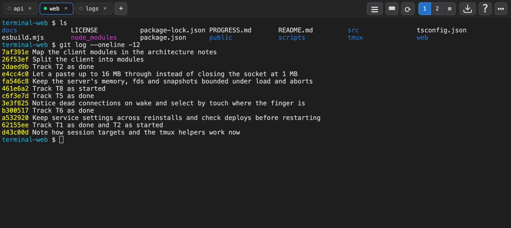
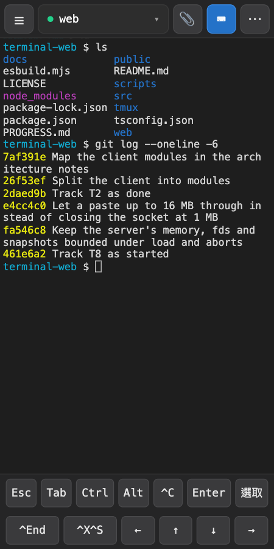

# terminal-web

A web-based terminal: open a browser tab, get a real shell. The shell runs
inside a **tmux** session, so closing the window (or losing your network) just
detaches — your programs keep running and reattach when you come back. Open it
on your laptop and keep going from your phone — it's the **same live session**.

<table>
  <tr>
    <td></td>
    <td width="34%"></td>
  </tr>
</table>

Built with [xterm.js](https://xtermjs.org/) on the front end and a small
Node.js + TypeScript server using [`ws`](https://github.com/websockets/ws) and
[`node-pty`](https://github.com/microsoft/node-pty) on the back end.

> ⚠️ **Anyone who can reach the server gets a shell as the user running it.**
> It is meant to live on a private network such as your **Tailnet**: by default
> it binds your Tailscale IP, and requests that reach it directly need **no
> login at all**. The optional `AUTH_TOKEN` protects **only requests that come
> through Cloudflare** (a Cloudflare Tunnel). Every other path — the tailnet, a
> LAN with `HOST=0.0.0.0`, ngrok, Tailscale Funnel, an nginx reverse proxy — is
> completely open. Don't expose it any other way. See [Security](#security).

**Features**

- **Resumable** sessions (tmux) — survive disconnect, refresh, sleep and, with
  tmux-resurrect, a reboot
- **Multi-session tabs** — open (`+`), rename (double-click/double-tap), close
  (`×`, asks first), restart (`⟳`); the tab list **syncs across all your
  devices**
- **Split view** — a second terminal beside each tab, side by side or stacked
- **Mobile layout + installable PWA** — compact top bar, a sessions drawer, an
  on-screen key bar (Esc/Tab/sticky Ctrl·Alt, `^C`, arrows) and touch text
  selection
- **Copy & paste** that works over plain HTTP (no HTTPS required)
- **Attach any file** (picker / paste / drag) → upload → insert path, for
  **Claude Code** and other AI CLIs; **download** a file from the host
- Font size, fullscreen, IME (CJK) input, and a `?` help overlay
- Through a Cloudflare Tunnel: sign in with a shared token or, optionally, a
  **passkey**
- Optional **background service** (launchd on macOS, systemd on Linux) and a
  checked **deploy** script

---

## Quickstart

```bash
git clone https://github.com/AaronFei/terminal-web.git && cd terminal-web
sudo apt install tmux     # or: brew install tmux
npm install               # needs Node 20+
npm run build
bash scripts/start.sh     # binds your Tailscale IP and prints the URL
# no Tailscale?  HOST=192.168.1.50 bash scripts/start.sh   (or HOST=0.0.0.0)
```

Open the printed `http://<host>:8090/`. Want it always-on (start at boot,
restart on crash)? `bash scripts/service.sh install` (launchd on macOS, systemd
on Linux). See [Run](#run) and [Without Tailscale](#without-tailscale-lan--intranet).

---

## Platforms & prerequisites

Supported: **macOS** and **Linux** (the service helper needs systemd on Linux).
Windows only through **WSL**. Development is done on macOS; a Linux box runs it
as a systemd service.

Not bundled or installed by this project:

- **Node.js 20+** (ESM; the server runs via `tsx`)
- **tmux** — the session backend (`brew install tmux`, `sudo apt install tmux`).
  tmux 3.4 has been seen to crash inside `kill-session`, taking every session
  with it; a newer tmux is recommended (see [Persistence](#persistence-across-reboots)
  for the safety net).
- **tailscale** — optional, only used to pick the bind address. Without it, set
  `HOST` yourself (see [Without Tailscale](#without-tailscale-lan--intranet)).
- **tmux-resurrect + tmux-continuum** — optional, for sessions that survive a
  reboot (see [Persistence](#persistence-across-reboots)).

---

## Install

```bash
npm install
```

`node-pty` is a native addon, pinned to **`1.2.0-beta.14`** (it fixes a macOS
fd leak that once filled the system's pty table). That release ships
**prebuilt binaries** for macOS and Linux on x64 and arm64, so normally nothing
is compiled. Only when no prebuilt matches does it fall back to building from
source, which needs a C/C++ toolchain and Python 3
(`sudo apt install -y build-essential python3`, or `xcode-select --install` on
macOS).

`npm install` also runs a postinstall step (`scripts/fix-pty-perms.mjs`) that
makes node-pty's prebuilt `spawn-helper` executable; some npm versions unpack
it without the execute bit.

---

## Build

Bundle the client (`web/*.ts` + xterm.js and addons) with esbuild into
`public/dist/`:

```bash
npm run build
```

This produces `public/dist/terminal.js` and `public/dist/terminal.css`.
`public/dist/` is gitignored. The server stamps every asset URL in `index.html`
with a build hash (`?v=…`), so browsers and CDNs pick up a new build at once.

---

## Run

### Quick start (recommended)

```bash
bash scripts/start.sh
# or, without Tailscale detection or an auto-build:
HOST=100.x.y.z npm start
```

`scripts/start.sh`:

1. Loads `.env` if present.
2. Warns if `tmux` or `tailscale` are missing.
3. Builds the client bundle if `public/dist/terminal.js` is absent.
4. Uses `HOST` if set, else your Tailscale IPv4 (`tailscale ip -4`). With
   neither it **refuses to start** rather than bind every interface on its own;
   pass `HOST=0.0.0.0` to do that on purpose.
5. Runs `npm start` and prints the URL.

`npm start` alone just runs `tsx src/server.ts`. The server also detects the
Tailscale IP when `HOST` is unset, but unlike the scripts it **falls back to
`0.0.0.0`** when there is none. It logs the URLs it binds.

### Without Tailscale (LAN / intranet)

Tailscale is optional — it's only used to pick the bind address:

```bash
# bind to a specific LAN/intranet IP...
HOST=192.168.1.50 PORT=8090 bash scripts/start.sh
# ...or bind every interface (reachable on all of the host's IPs)
HOST=0.0.0.0 PORT=8090 bash scripts/start.sh
```

Open `http://<that-ip>:8090/` from any machine that can reach it.

> **Security:** this is plain HTTP with **no login** — `AUTH_TOKEN` does not
> apply here. Anyone who can reach the bound `IP:port` gets a full shell. On a
> shared LAN that is everyone on the segment. See [Security](#security).

### Development

```bash
npm run dev   # -> bash scripts/dev.sh
```

`scripts/dev.sh` loads `.env`, runs the esbuild watcher
(`node esbuild.mjs --watch`) in the background and the server with reload
(`tsx watch src/server.ts`) in the foreground. Editing `web/` rebuilds the
bundle; editing `src/` restarts the server. Stopping the script (Ctrl-C) stops
the watcher too.

---

## Running as a background service (launchd / systemd)

To keep terminal-web running across logins and reboots, install it as a
per-user service. The helper picks the platform — **launchd on macOS, systemd
`--user` on Linux**:

```bash
bash scripts/service.sh install     # write the unit, enable it, (re)start it
bash scripts/service.sh status      # state + an HTTP probe
bash scripts/service.sh logs        # tail the logs
bash scripts/service.sh restart     # after changing server code
bash scripts/service.sh uninstall   # stop and remove
```

`install` pins the node binary, the repo path and the environment into the
unit, enables it, and **restarts** it so a changed unit takes effect. The
service runs straight out of this checkout and restarts 10 s after it exits.

- **Bind address.** `HOST` if given, else the value already installed, else
  your Tailscale IPv4. With none of those, install **refuses** rather than bind
  `0.0.0.0`; pass `HOST=0.0.0.0` to do that on purpose.
- **Reinstalling keeps your settings.** Anything you don't pass again — `HOST`,
  `PORT`, `DEFAULT_SESSION`, `AUTH_TOKEN`, the service `PATH`, and any other
  variables you added to the unit by hand — is carried over from the installed
  unit/plist, and install prints what it kept. An empty `AUTH_TOKEN=` counts as
  "not given" (so the token isn't dropped by accident).
- **PATH.** On a fresh install: node's directory, tailscale's, and the system
  dirs. `SERVICE_PATH=…` replaces it.
- **Where the token lives** (never in a world-readable file):
  - Linux: `~/.config/terminal-web/env` (mode 0600), loaded with
    `EnvironmentFile=`. Edit it and `restart` to change the token.
  - macOS: inline in the plist, which install writes 0600 (launchd has no
    `EnvironmentFile`).
- **macOS:** `~/Library/LaunchAgents/com.aaronfei.terminal-web.plist`; logs in
  `logs/launchd.out.log` / `logs/launchd.err.log`; a log past 10 MB is rotated
  on the next `install` or `restart`.
- **Linux:** `~/.config/systemd/user/terminal-web.service` with
  **`KillMode=process`**, so a restart stops only the node process and **tmux
  (with everything running in it) survives**. It tries
  `loginctl enable-linger` so the service runs without a login session (run
  `sudo loginctl enable-linger $USER` yourself if that fails). Logs go to the
  journal (`journalctl --user -u terminal-web -f`).

The service does not read `.env`; set variables on the `install` command line.

### Updating: `scripts/deploy.sh`

After pulling new code, deploy it with:

```bash
bash scripts/deploy.sh             # deps if needed, typecheck, build, restart, verify
bash scripts/deploy.sh --dry-run   # report only
```

It:

1. Shows what is about to ship (HEAD, ahead/behind, and a warning for
   uncommitted changes).
2. Runs `npm ci` when `package-lock.json` changed since the last install on
   this machine (the hash is kept in the untracked `.deploy/` directory).
3. Typechecks (`npx tsc --noEmit -p .`) and **stops without restarting** on
   errors.
4. Builds the client and restarts the service through `service.sh`.
5. Asks `GET /api/health` which commit the restarted server runs and fails if
   it isn't this checkout's HEAD.

Afterwards, hard-refresh open browsers.

It also understands a "mirror" layout, where the service runs from a separate
copy kept in sync with rsync; `scripts/use-repo-as-live.sh` converts such a
host to run straight from the checkout. Both are maintainer tools for one
particular host setup; a normal install (via `service.sh`) never needs them.

---

## Architecture

```
                     WebSocket: /ws?session=NAME&cols=C&rows=R
                      binary = raw bytes, text = JSON control
  +-----------------+  <------------------------------------->  +--------------------+
  |     Browser     |                                           |   Node.js server   |
  |   (xterm.js)    |  --- input bytes (binary frame) ------->  |   ws + node-pty    |
  |  FitAddon       |  <-- output bytes (binary frame) -------  |                    |
  |  WebLinksAddon  |  --- resize|ping|restart|debug (text) ->  |   one pty per      |
  |  WebglAddon     |  <-- pong|info|closed (text) -----------  |   connection       |
  +-----------------+                                           +---------+----------+
         ^                                                                |
         | HTTP: static files, /upload, /api/*                            | pty runs:
         +----------------------------------------------------------------+  tmux new-session -A -s NAME
                                                                          v
                                                              +-------------------------+
                                                              |     tmux server         |
                                                              |  session "NAME" ------> | your shell + programs
                                                              |  (survives disconnect)  |
                                                              +-------------------------+
```

- The browser streams keystrokes as **binary** WebSocket frames; the server
  writes them to the pty. The pty's output comes back as binary frames.
- **Text** frames carry JSON control messages (see `src/types.ts`):
  - client → server: `resize {cols, rows}`, `ping`, `restart` (kill this
    session so the reconnect starts a fresh one), `debug` (a trace line for the
    server log; see [Debug flags](#debug-flags));
  - server → client: `pong`, `info {message}`, `closed` (the session was
    closed, here or on another device: drop the tab, don't reconnect).
- The WebSocket query takes `session` (the tmux session name), `create=1`
  (allowed to create a session that was recently closed), and `cols`/`rows`
  (the size to start the pty at, so attaching doesn't resize tmux). Without
  `session`, `DEFAULT_SESSION` is used.
- A single client message is capped at **16 MB**; a bigger one closes the
  socket.
- Closing a tab is not a WebSocket message: the page calls
  `POST /api/sessions/kill`, because the tab may not be connected at all.
- The pty runs `tmux new-session -A -s NAME`, so the same named session is
  reused (or created) on every connect. The tmux server outlives the pty.

The source is split into `src/` (server) and `web/` (client modules, entry
`web/terminal.ts`). [`docs/ARCHITECTURE.md`](docs/ARCHITECTURE.md) maps every
file and lists the invariants changes must keep.

---

## How resume works

The pty doesn't run your shell directly — it runs
`tmux new-session -A -s NAME` (`-A`: attach if it exists, else create). So:

- **Disconnecting** — closing the *browser* tab/window, refreshing, sleeping
  the laptop, or dropping Wi-Fi — closes the WebSocket. The server kills the
  pty, which only **detaches** the tmux client. Your session and every program
  in it keep running.
- **Reconnecting** opens a new WebSocket, spawns a new pty, and re-attaches to
  the same session. tmux repaints the screen and you're back where you left
  off.

> Closing a **tab inside the app** (the `×`) is different: it *kills* that tmux
> session for good. To keep a job running, just close the window or let the
> connection drop. See [Sessions & tabs](#sessions--tabs).

**Connection health.** A dead connection is noticed quickly — an unanswered
ping (40 s), or within 5 s of coming back to the page after sleep — and the
terminal reconnects at once; otherwise retries back off from 0.5 s to 5 s. A
"reconnecting…" notice shows meanwhile.

---

## Persistence across reboots

tmux keeps sessions alive across disconnects, but not across a reboot (or a
crash of the tmux server). For that, `tmux/web.tmux.conf` loads
[tmux-resurrect](https://github.com/tmux-plugins/tmux-resurrect) and
[tmux-continuum](https://github.com/tmux-plugins/tmux-continuum) when they are
installed. Install them with plain `git clone` (no TPM):

```bash
git clone https://github.com/tmux-plugins/tmux-resurrect ~/.tmux/plugins/tmux-resurrect
git clone https://github.com/tmux-plugins/tmux-continuum ~/.tmux/plugins/tmux-continuum
```

- **Saving** is done by the terminal-web server, not by continuum (continuum's
  timer needs the tmux status line, which this config hides). It runs
  resurrect's save script **90 s after starting, every 5 minutes, and right
  before every kill or restart** of a session. A save that would replace the
  last snapshot with a sudden much smaller set of sessions is skipped (for up
  to two hours), so a crash doesn't overwrite the record of what was there.
- **Restoring** is continuum's: when the tmux server starts after a reboot, it
  restores the last snapshot — windows, working directories, pane contents, and
  `claude` relaunched where it was running (`@resurrect-processes`).
- **Tabs come back too.** A restore drops the tab markers, so a device that
  still remembers its tabs asks the server to re-adopt the restored sessions
  (`POST /api/sessions/adopt`).

Without the plugins everything works except surviving a reboot.

---

## How scrolling works

Scrolling is handled by **tmux** (`tmux/web.tmux.conf`):

- `set -g mouse on` — the mouse wheel enters tmux copy-mode to browse history;
  scrolling back to the bottom returns to the live shell. On a touch screen,
  drag one finger up or down.
- `set -g history-limit 100000` — deep scrollback (costs memory per pane).

xterm.js itself sits on tmux's alternate screen, which has no scrollback; the
history you browse is tmux's.

> The tmux status bar is hidden (`set -g status off`). To bring it back,
> comment out that line, or run `tmux set -g status on`.

---

## Controls, key bar & touch

- **Top bar (desktop / tablet)** — session **tabs** on the left (a dot shows
  each one's connection; hollow = not opened yet), `+` for a new one. On the
  right: `☰` (session list), `⌨` (toggle the key bar), `⟳` (restart the
  session), **`1` `2` `⊞`** (split view), `⬇` (download a file from the host),
  `?` (help) and `⋯`.
- **Phone top bar** (narrower than 640 px) — `☰`, the current session's name
  (tap for the session drawer), `📎` (attach a file), `⌨`, `⋯`.
- **`⋯` actions sheet** — font size (A− / A+), split view, restart,
  **📋 Paste**, **⧉ Copy the screen**, **📎 Attach a file**, download,
  fullscreen, help.
- **Key bar** — `Esc` `Tab` `Ctrl` `Alt` `^C` `Enter` `選取`, then (on a phone,
  on its own row) `^End` `^X^S` `←` `↑` `↓` `→`.
  - `Ctrl` and `Alt` are **sticky**: tap to arm (they highlight), and the next
    key is sent with that modifier — `Ctrl` then `c` is `Ctrl-C`;
    `Ctrl`/`Alt` + an arrow sends the xterm modified sequence.
  - `^End` sends Ctrl+End (jumps to the bottom in Claude Code's fullscreen
    view).
  - `^X^S` sends Ctrl+X then Ctrl+S in one tap (emacs's save).
  - `選取` toggles touch selection mode (see [Copy & paste](#copy-paste--clipboard)).
  - A key pressed while the terminal is **disconnected is dropped**, not sent
    later, with a brief 「未連線，按鍵沒有送出」 notice.

  The key bar shows by default on touch devices and is hidden on desktop; your
  choice is remembered. On touch, tapping a key doesn't move focus, so the soft
  keyboard stays as it was.
- **Soft keyboard.** When the phone's keyboard opens, the terminal **slides
  up** only as far as needed to keep the prompt visible, and **never resizes**
  (a resize would make full-screen programs like Claude Code lose rows). While
  the keyboard stays up the slide only grows, so it doesn't bounce as a program
  redraws. The key bar sits above the keyboard.
- **Embedded in an iframe.** Inside a frame, the page can't see the keyboard
  itself, so a launcher page that embeds terminal-web can tell it: post
  `{source: 'entry', type: 'viewport', covered: N}` to the frame, where `N` is
  how many CSS pixels at the bottom of the frame the keyboard covers (0 when
  it's down). On load, the framed page posts
  `{source: 'terminal-web', type: 'viewport-please'}` to its parent to ask for
  the current value. For passkeys inside the frame, see [Security](#security).

---

## Sessions & tabs

Each tab is a tmux session.

- **`+`** opens a new session (you're asked for a name). Names may use
  `A-Z a-z 0-9 _ -`, up to **61** characters (so the split's second session,
  `NAME__b`, still fits tmux names of up to 64).
- **Double-click / double-tap** a tab to rename it. Only the label changes; the
  tmux session keeps its name.
- **`×`** closes the tab **and kills its tmux session** (and the second half of
  a split), after asking. Before killing, the server takes a tmux-resurrect
  snapshot. The name is then remembered as closed for **30 days**
  (`~/.terminal-web/closed.json`), so a device that slept through the close
  can't recreate it by reconnecting; it drops the tab instead. Opening a new tab
  under that name on purpose works as usual.
- **`⟳`** restarts the active session: snapshot, kill, reconnect into a fresh
  one.
- **Tabs connect lazily**: a tab opens its connection the first time you look
  at it, so many tabs cost nothing until used.
- The tab list is the same on every device and syncs every few seconds.

### What the server remembers

| What | Where it lives |
|---|---|
| Which sessions are tabs, and their labels | the tmux sessions themselves (`@twtab` / `@twlabel` options) |
| Font size, key bar shown, the tab you were on (per device class: `touch` / `desktop`) | `~/.terminal-web/prefs.json`, via `GET`/`POST /api/prefs` |
| Recently closed tab names (30 days) | `~/.terminal-web/closed.json` |
| Sign-in sessions through Cloudflare: a SHA-256 of each session id (never the id or the token), how it was made, when it expires | `~/.terminal-web/auth-sessions.json` (0600) |
| Registered passkeys: credential id, public key, counter, RP ID (hostname), name, dates | `~/.terminal-web/passkeys.json` (0600) |
| Uploaded files | `UPLOAD_DIR` (default `~/terminal-web-uploads`) |
| Session snapshots | `~/.local/share/tmux/resurrect` (tmux-resurrect) |
| Split view per tab | this browser's `localStorage` only |

`localStorage` also caches the tabs and prefs, because it is instant and works
offline, but the server's copy is what restores them. That matters when the
page runs in a cross-origin iframe (embedded in a launcher page), where iOS can
drop the frame's storage whenever the app is closed. Pref writes are coalesced
(400 ms) and flushed with `sendBeacon` on `pagehide`.

### Split view: two terminals per tab

A tab can show a **second terminal**; `1` `2` `⊞` in the top bar (or **Split
view** in the `⋯` sheet) picks what you see:

| | |
|---|---|
| `1` | the first terminal fills the tab; the second keeps running out of sight |
| `2` | the second fills the tab; the first keeps running out of sight |
| `⊞` | both: **side by side** on a wide screen, **stacked** when the pane is narrower than 760 px; rotating the device restacks them |

The second terminal is **a separate tmux session** named after the first:
`work` has `work__b`. It is created the first time you press `2` or `⊞`, and it
starts in the **first terminal's working directory**. The `__b` suffix is
reserved: such a session shows up as part of its tab, not as a tab of its own.
Switching views never closes anything; closing the tab closes both.

Why not tmux's own split? A tmux split is drawn into one grid with the divider
as characters inside it, and once the browser's grid and tmux's model drifted
the border was drawn crooked. Two sessions each get their own pty, size,
selection and clipboard, and the gap between them is CSS. A split you make
**inside** tmux (`Ctrl-b %`) still works, as one terminal.

Which view each tab uses is remembered **per device** (in `localStorage`): a
phone and a desktop looking at the same work want different answers.

### Opening a specific session

```
http://<host>:<port>/?session=work
```

opens (or creates) `work` alongside your other tabs and switches to it. Without
`?session=`, the page reopens the tabs you had; on a first visit with no tabs
anywhere it opens `web`. (`DEFAULT_SESSION` only matters to raw WebSocket
clients that connect without a `session`.) Characters outside `A-Z a-z 0-9 _ -`
are dropped from the name.

---

## Copy, paste & clipboard

The browser Clipboard **API** needs a *secure context* (HTTPS or
`http://localhost`), so over a plain `http://<ip>` URL much of it is blocked.
This app works around that, so HTTPS isn't required.

**Desktop**

- **Select:** tmux's mouse mode owns plain dragging, so hold **Option**
  (macOS) or **Shift** (Windows/Linux) and drag. Letting go **copies** the
  selection.
- **macOS:** ⌘C / ⌘V as usual.
- **Windows/Linux:** **Ctrl+V** pastes (the browser's own paste, so text,
  images and files all work over HTTP), **Ctrl+Shift+V** pastes too (over plain
  HTTP through the paste box), and
  **Ctrl+Shift+C** copies the selection. Plain Ctrl+C stays `^C`. Since Ctrl+V
  no longer sends `^V`, use **Ctrl+Q**, which vim (visual block) and readline
  (quoted insert) accept in its place.

**Touch (phone / tablet)**

- **Copy:** tap **選取** on the key bar, then drag over the text — or just
  **long-press a word** to select it. Adjust either end with the drag
  handles, then tap **複製** on the selection bar (**全選** selects the whole
  screen, **取消** cancels). **⋯ → ⧉ Copy the screen** does select-all and copy
  in one tap.
- **Paste:** **⋯ → 📋 Paste**. Over HTTPS it pastes directly; over plain HTTP a
  small box opens — paste into it and it's sent to the terminal.

The key bar has no Copy or Paste keys. The `?` help overlay summarizes these,
with the right keys for your OS.

---

## Attaching and downloading files

A terminal is a text stream, so you can't paste a file into it. Instead, each
of these uploads the file to the server (`POST /upload`), which saves it under
`UPLOAD_DIR` (default `~/terminal-web-uploads`), and the page then **types its
absolute path at the prompt**:

- **⋯ → 📎 Attach a file** (a phone also has 📎 on its top bar) — pick one or
  more files. Works everywhere, including iPad, over plain HTTP.
- **Paste** a file or image (Cmd/Ctrl+V) into the terminal.
- **Drag and drop** files onto the terminal.

So to hand a file to Claude Code (or any CLI that reads a path): attach it,
then press Enter. The saved file keeps its (sanitized) name with a
`clip-<timestamp>-` prefix, is written `0600`, and is capped at `UPLOAD_MAX_MB`
(default 1024 MB). An uploaded path typed while the connection is down is sent
when it comes back.

Uploads are pruned on boot and after each upload: files older than
`UPLOAD_RETENTION_HOURS` (default 72) go, then only the newest
`UPLOAD_MAX_FILES` (default 100) are kept. Only the server's own `clip-*` files
are touched. Set either to `0` to turn that limit off.

**Download** goes the other way: `⬇` (or **⋯ → Download a file**) asks for a
path and downloads that file to your device. A relative path is resolved
against the active terminal's current directory, `~/…` against the home
directory.

---

## Environment variables

All are optional. Copy `.env.example` to `.env` to override defaults. `.env`
is loaded by `scripts/start.sh` and `scripts/dev.sh`, not by `npm start` or the
installed service (pass variables to `service.sh install` instead). None of
these variables are passed on to the terminal's shell.

| Variable | Default | Description |
| --- | --- | --- |
| `PORT` | `8090` | Port the HTTP/WebSocket server listens on. |
| `HOST` | Tailscale IPv4, else `0.0.0.0` | Address to bind. `start.sh` and `service.sh` refuse the `0.0.0.0` fallback; set `HOST=0.0.0.0` explicitly for that. |
| `AUTH_TOKEN` | _(empty)_ | Shared token for requests **through Cloudflare** only. Empty = those requests are refused (403). See [Security](#security). |
| `ALLOWED_HOSTS` | _(empty)_ | Comma-separated extra hostnames accepted in the `Host` header of direct requests (see [Security](#security)). |
| `MAX_PTYS` | `48` | Most terminals open at once (minimum 1); further connections are refused. |
| `DEFAULT_SESSION` | `web` | Session for a WebSocket client that sends no `session`. The bundled page always sends one. An invalid name stops the server at startup. |
| `UPLOAD_DIR` | `~/terminal-web-uploads` | Where attached/pasted/dropped files are saved. |
| `UPLOAD_MAX_MB` | `1024` | Largest single upload in MB (0 = no limit). |
| `UPLOAD_RETENTION_HOURS` | `72` | Delete uploads older than this (0 = never by age). |
| `UPLOAD_MAX_FILES` | `100` | Keep at most this many uploads, newest first (0 = unlimited). |
| `TERMINAL_WEB_TMUX_SOCKET` | _(empty)_ | Testing: run every tmux call as `tmux -L <name>` (a separate tmux server) and turn snapshots off. |

---

## HTTP API

Used by the page; listed here for scripts and reviewers. Through Cloudflare
every route needs the sign-in cookie.

| Method & path | What it does |
| --- | --- |
| `GET /ws` (upgrade) | The terminal WebSocket (see [Architecture](#architecture)). |
| `POST /upload?name=FILE` | Raw file body → saved under `UPLOAD_DIR`; returns `{path, name, size}`. 413 over the size cap. |
| `GET /api/sessions` | The tab list: `{tabs: [{name, displayName}]}` (`tabs: null` if tmux can't be asked). |
| `POST /api/sessions/rename` | `{name, displayName}` — set a tab's label. |
| `POST /api/sessions/kill` | `{name}` — close a tab: snapshot, then kill it and its `__b` half. |
| `POST /api/sessions/adopt` | `{names: [...]}` — mark existing sessions as tabs again (after a restore); returns `{adopted}`. |
| `GET /api/prefs?scope=touch\|desktop` | `{prefs: {fontSize, keybar, activeTab}}` for that device class. |
| `POST /api/prefs` | `{scope, fontSize?, keybar?, activeTab?}` — merge into that device class's prefs. |
| `GET\|HEAD /api/download?path=P&session=S` | Download any regular file the server's user can read. Relative `P` resolves against session `S`'s current directory, `~/…` against home. |
| `GET /api/health` | `{ok, commit, startedAt}` — the commit the running server was started from. |
| `POST /login` | The sign-in form, `token=…` (Cloudflare-fronted requests only; elsewhere it just redirects to `/`). |
| `POST /logout` | Sign out: forget this session, clear the cookie, 303 to `/`. |
| `POST /auth/passkey/login/options` | Start a passkey sign-in: `{challengeId, options}`. Needs no cookie; Cloudflare-fronted only (404 otherwise). |
| `POST /auth/passkey/login/verify` | `{challengeId, response}` — finish it; sets the session cookie. 401 if the passkey isn't accepted. Cloudflare-fronted only. |
| `GET /api/auth` | `{viaCloudflare, method: "token"\|"passkey"\|"legacy"\|null, passkeyCapable}` — how this request is signed in. |
| `GET /api/passkeys` | `[{id, name, rpId, createdAt, lastUsedAt}]` — the registered passkeys (no keys). Works over the tailnet too. |
| `POST /api/passkeys/delete` | `{id}` — remove a passkey and sign out every session it made. Works over the tailnet too. |
| `POST /api/passkeys/register/options` | Start adding a passkey: `{challengeId, options}`. Signed in, Cloudflare-fronted only. |
| `POST /api/passkeys/register/verify` | `{challengeId, response, name?}` — finish it (name ≤ 64 characters; defaults to the device type). |

---

## Security

**Anyone who can reach the server gets an interactive shell as the user running
it** — and can download any file that user can read (`GET /api/download`) and
upload files. Treat exposing it like handing out SSH access.

**What protects it**

- **Direct access (tailnet, LAN, localhost, any proxy or tunnel other than
  Cloudflare) has no login at all.** Keep it on a network you trust: leave
  `HOST` on your Tailscale IP (the default) and use Tailscale ACLs to limit
  which devices reach the port. Don't bind `0.0.0.0` on an untrusted network,
  and **don't publish it through ngrok, Tailscale Funnel, an nginx reverse
  proxy or the like** — none of those get a login.
- **`AUTH_TOKEN` gates only requests that arrive through Cloudflare**, which it
  recognizes by the `Cf-Ray` / `Cf-Connecting-Ip` headers Cloudflare adds. Such
  a request gets a sign-in page that POSTs the token to `/login`; a correct
  token sets an **HttpOnly** cookie (`SameSite=Lax`, **Secure** when the request
  came over HTTPS, as it does through Cloudflare) and the WebSocket requires it
  too. The cookie holds a random session id the server issued, not the token;
  the server keeps only a SHA-256 of it, in `~/.terminal-web/auth-sessions.json`
  (0600). A session made with the token ends when `AUTH_TOKEN` changes, so
  rotating the token signs every token session out. A cookie from before
  sessions existed (it held the token itself) is still accepted while the token
  is unchanged, and swapped for a session on the next page load. An old-style
  `?token=…` link still works on a GET and is redirected to the same URL
  without the token. **With `AUTH_TOKEN` empty, every Cloudflare-fronted
  request is refused (403)**, so a tunnel set up before the token isn't a public
  shell. Use a long random token (`openssl rand -hex 24`); a shared token is not
  per-user identity — put Cloudflare Access in front for that.
- **Passkeys (optional).** Through Cloudflare you can also sign in with a
  passkey (Face ID, Touch ID, Windows Hello, a phone or a security key) instead
  of typing the token. The token always keeps working; passkeys are an extra
  way in, not a replacement. To add one, sign in with the token through the
  https address, then **⋯ → Passkeys → Add a passkey**. Each hostname has its
  own passkeys (the WebAuthn RP ID is the request's hostname), so every machine
  you run this on registers its own; a tailnet address can't hold one. The
  same panel lists them, deletes one (which signs out every session it made)
  and signs you out. Listing and deleting also work over the tailnet, which is
  the way back in if a device is lost; deleting `~/.terminal-web/passkeys.json`
  and restarting removes them all. Passkeys inside a cross-origin iframe (a
  launcher page) only work if the frame allows them:
  `<iframe allow="publickey-credentials-get; publickey-credentials-create" …>`.
  Without that, sign in with the token inside the frame.
- **Sign out** (**⋯ → Passkeys → Sign out**, or `POST /logout`) ends the
  current session. To end all of them, change `AUTH_TOKEN` and delete the
  passkeys.
- **Host check (DNS rebinding).** A direct request whose `Host` is a dotted
  hostname that isn't an IP address, isn't a `*.ts.net` name, and isn't listed
  in `ALLOWED_HOSTS` gets 403. Single-label names (`localhost`, a MagicDNS short
  name) are allowed. Add your own names (say, a LAN DNS name) to
  `ALLOWED_HOSTS`.
- **Origin check (cross-site requests).** The WebSocket upgrade and every
  non-GET request (all the POSTs) are refused with 403 when they carry an
  `Origin` from another site, or `Origin: null`. A request with no `Origin`
  (curl, scripts) is allowed. The check compares `Origin` with the `Host`
  header, so a proxy or tunnel in front must pass the original `Host` through
  (cloudflared does by default).
- **No secrets in the shell.** The server's own configuration variables,
  `AUTH_TOKEN` included, are removed from the environment the terminal's shell
  starts with.

**Plain HTTP.** The server speaks HTTP, not HTTPS, so the browser's clipboard
API is mostly blocked; copy and paste use fallbacks (see
[Copy, paste & clipboard](#copy-paste--clipboard)). For HTTPS on the tailnet,
put it behind `tailscale serve` (tailnet-only, not Funnel).

---

## Debug flags

URL parameters, for diagnosing on a device you can't open a console on:

- `?debug=ime`, `?debug=vv`, `?debug=paste`, `?debug=sel` — trace IME/keyboard
  input, visual-viewport (soft keyboard) measurements, paste events, or touch
  selection. Combine them (`?debug=ime,sel`). Traces are sent over the
  WebSocket and written to the **server's log**. `ime` also logs an `env` line
  per connection (platform, touch support, user agent), handy for telling which
  device a report came from.
- `?webgl=0` or `?nowebgl` — use xterm's DOM renderer instead of WebGL.

---

## Troubleshooting

**`posix_spawnp failed` when a terminal opens**
node-pty's `spawn-helper` lost its execute bit. Re-run `npm install` (its
postinstall step fixes the mode).

**`node-pty` fails to install / node-gyp errors**
No prebuilt binary matched, so it tried to compile. Install a toolchain
(`xcode-select --install` on macOS; `sudo apt install -y build-essential
python3` on Debian/Ubuntu), then `rm -rf node_modules && npm install`.

**"tmux: command not found" / sessions don't start**
Install tmux (`brew install tmux`, `sudo apt install tmux`). Under the
service, tmux must be on the service's `PATH` (`SERVICE_PATH=… bash
scripts/service.sh install`).

**Port already in use (`EADDRINUSE`)**
Find the holder with `lsof -i :8090` and stop it, or use another port:
`PORT=8091 bash scripts/start.sh`.

**`start.sh` / `service.sh install` refuse to start without Tailscale**
Bring Tailscale up (`tailscale up`; `tailscale ip -4` should print an address),
or set `HOST` explicitly.

**403 "Host not allowed"**
You reached the server by a hostname it doesn't know. Add it to
`ALLOWED_HOSTS`.

**403 through Cloudflare**
`AUTH_TOKEN` isn't set on the server. Set it and restart.

**Passkey sign-in says "not accepted"**
A passkey only works on the hostname it was added on; check **⋯ → Passkeys**
for its RP ID. The server expects the browser's origin to be
`https://<host>`, which it learns from the `X-Forwarded-Proto` header
cloudflared sends; a proxy in between must keep it. The token always works.

**Client shows "reconnecting…" and never connects**
The server may not be running, you can't reach `HOST:PORT`, or `MAX_PTYS`
terminals are already open. Check the server log.

**Blank page / terminal doesn't render**
Build the client (`npm run build`) and check the browser console for errors
loading `/dist/terminal.js`.

**Garbled glyphs / blank terminal on an old or virtual GPU**
Append `?webgl=0` to the URL to use the DOM renderer.

---

## Contributing

Issues and pull requests are welcome.

```bash
npm install && npm run build && npm run dev   # watcher + auto-restarting server
```

- **Checks.** There is no unit-test suite. Every change must pass
  `npx tsc --noEmit -p .` and `npm run build`. For anything that touches the
  page or the server, also run the headless smoke test:

  ```bash
  npm run build && npm run smoke
  ```

  It starts a scratch server on a separate tmux socket (`-L`) with a scratch
  `HOME` on `127.0.0.1:18098`, drives it with headless Chrome (attach, type,
  new tab, switch, split, resize) and checks your own tmux sessions are
  untouched. It needs Chrome or Chromium (`CHROME=/path` to choose one).
  `bash scripts/smoke/run-smoke.sh --screenshots` regenerates the images in
  `docs/` the same way. For anything that touches sign-in, also run
  `npm run smoke:passkey`: it fakes Cloudflare with a `cf-ray` header, uses
  test tokens and a virtual WebAuthn authenticator on `http://localhost`, and
  covers token and passkey sign-in, the legacy cookie, sign-out, challenge
  replay, a token change, deleting a passkey and the tailnet staying open.
- **Never test against your real tmux.** If you run a server by hand, give it
  `TERMINAL_WEB_TMUX_SOCKET=<name>`, a scratch `HOME`, and a port other than
  your real one, and unset `TMUX` (it overrides everything else).
- **Platforms.** Check macOS and Linux behaviour where it matters; on the client,
  desktop browsers and iOS/Android touch.
- **Input handling is deliberately frozen.** The keyboard, IME and paste code
  in `web/session.ts` was tuned bug by bug against CJK input methods and iOS;
  changes there need a concrete bug and the smallest possible diff. See
  [`docs/ARCHITECTURE.md`](docs/ARCHITECTURE.md), which also lists the other
  invariants (the soft keyboard never resizes the pty, exact tmux targets,
  snapshots before kills, …).
- Small, focused PRs are easiest to review. For a big UI change or a protocol
  change, open an issue first.

---

## License

MIT © 2026 AaronFei. See [LICENSE](LICENSE).
